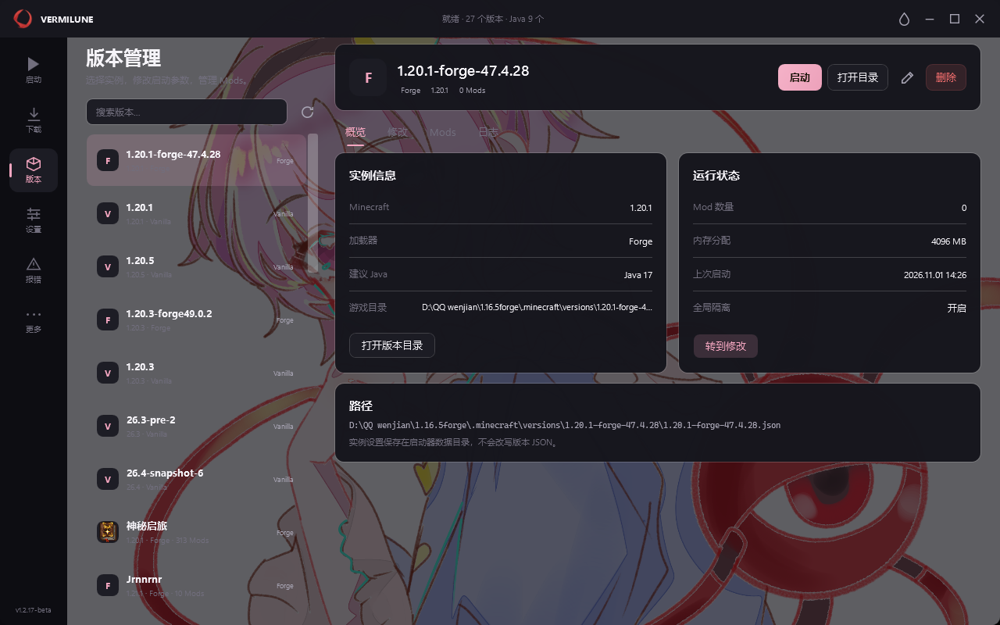
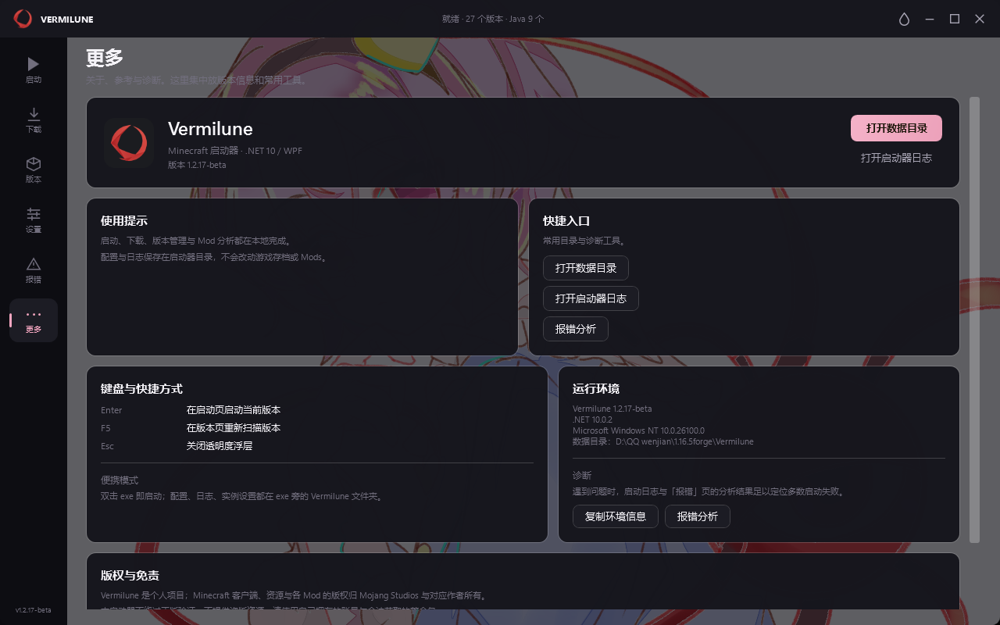

# Vermilune

一个使用 **.NET 10 + WPF** 编写的 Windows Minecraft 启动器，当前版本 **v1.2.0-beta**。

界面、版本管理、下载、登录与皮肤预览均在本地完成。

<p align="center">
  
</p>

## 功能

- 版本扫描、Java 自动检测、启动参数与内存配置
- Microsoft 设备代码登录、离线账号
- Forge / Fabric / NeoForge 安装
- Modrinth、CurseForge 资源搜索
- 整合包搜索与一键安装
- Mod 扫描、重复/前置/版本兼容检查与崩溃日志分析
- 本地皮肤库、Steve / Alex 模型切换、3D 皮肤预览
- Microsoft 账号皮肤与披风
- 深色 / 浅色主题、强调色、自定义背景与界面不透明度
- 无边框窗口、便携式数据目录

## 截图

<p align="center">
  
  
</p>

## 环境要求

- Windows 10 / 11 x64
- [.NET 10 Desktop Runtime](https://dotnet.microsoft.com/download/dotnet/10.0)
- 联网用于版本清单、资源下载与 Microsoft 登录

## 构建

```bash
git clone <repo-url>
cd Vermilune

dotnet build Vermilune.csproj -c Release

dotnet publish Vermilune.csproj -c Release -r win-x64 \
  --self-contained false \
  -p:PublishSingleFile=true \
  -p:IncludeNativeLibrariesForSelfExtract=true \
  -p:DebugType=none \
  -o publish
```

## 数据目录

程序首次运行后会在 exe 同级创建 `Vermilune` 文件夹：

```
Vermilune/
├─ launcher.json        # 设置
├─ logs/                # 日志
├─ Pictures/            # 自定义背景
├─ Skins/               # 本地皮肤库
│  └─ models.json       # Steve / Alex 模型记录
└─ cache/               # 资源与图标缓存
```

## 项目结构

```
Core/                   # 版本、下载、启动、账号、皮肤、Mod 分析
UI/Pages/               # 启动页、下载页、版本页、设置页等
UI/Controls/            # 3D 皮肤预览、异步图片等控件
UI/Dialogs/             # 登录、皮肤、披风、提示弹窗
Assets/                 # 图标与主页插图
```

## 说明

- 本项目不是 PCL 官方项目，与 PCL 作者无隶属关系。
- Minecraft 客户端、资源与 Mod 的版权归 Mojang Studios 及对应作者所有。

## 鸣谢

- [龙腾猫跃](https://meloong.com/)：PCL 作者。本项目部分代码参考了 [Plain Craft Launcher](https://github.com/Meloong-Git/PCL)。
- [SkinPilot](https://github.com/TsukaStore/SkinPilot)：3D 皮肤的模型尺寸、贴图盒、六面 UV 与内外层膨胀量参考其 `src/preview/skinGeometry.ts`。
- 主页 Satori 插图版权归原作者所有，仅用于界面展示。

## 许可

本项目原创代码采用 [MIT License](LICENSE)。

参考 PCL 的实现与 `Assets` 中的第三方素材不在 MIT 授权范围内，详见 [NOTICE](NOTICE)。PCL 使用《PCL 分发有限许可》，并非标准开源许可证；涉及相关部分时请阅读并遵守 [PCL 的许可要求](https://github.com/Meloong-Git/PCL/blob/master/LICENCE)。
